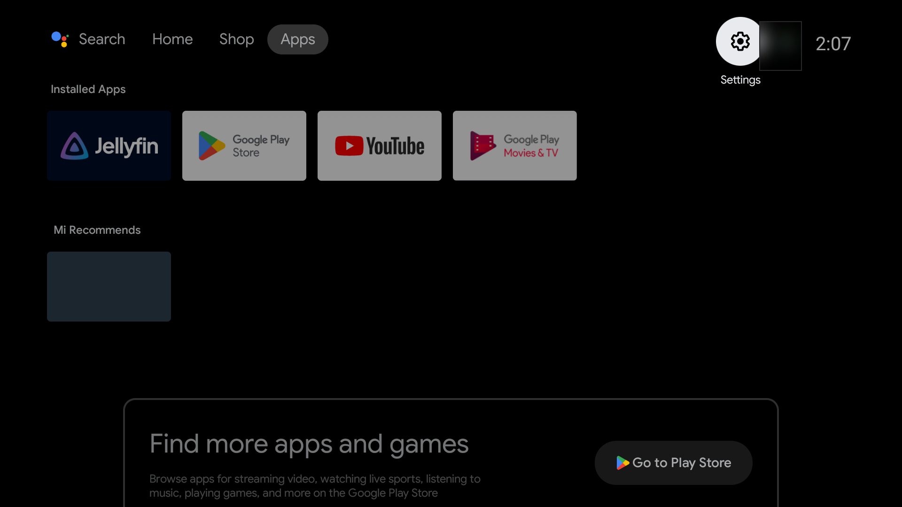
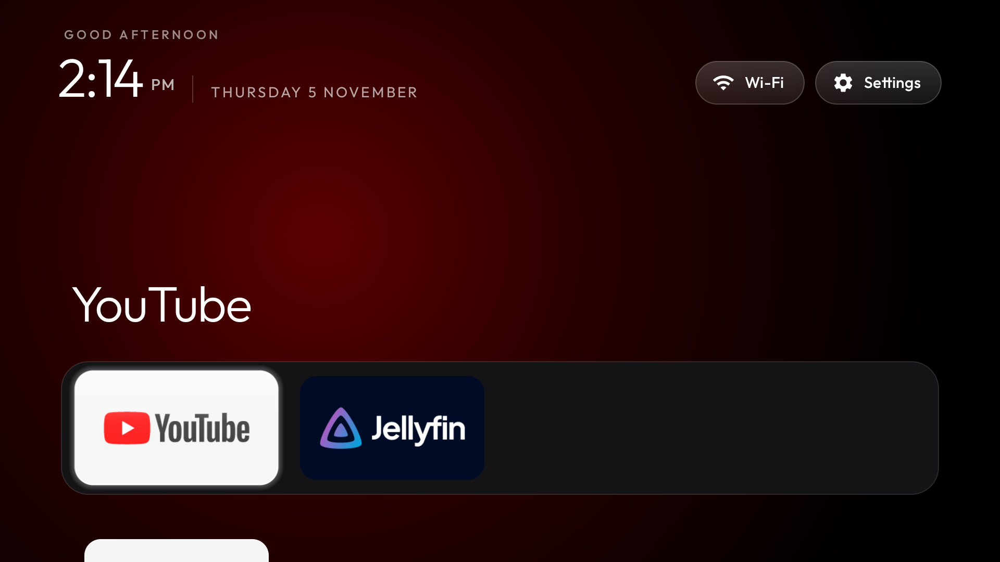
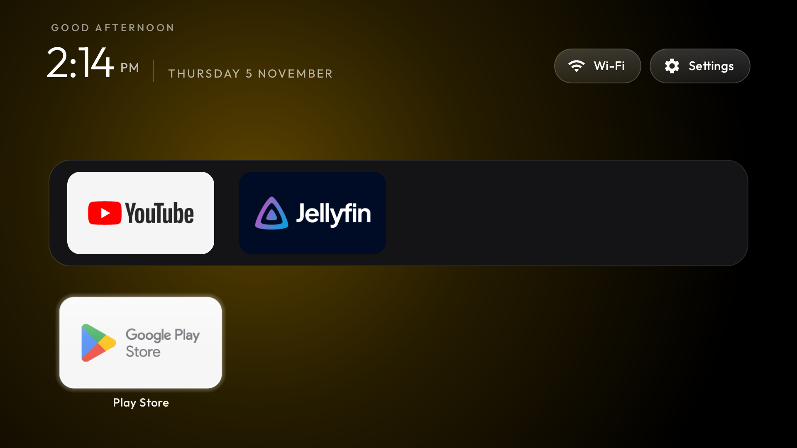
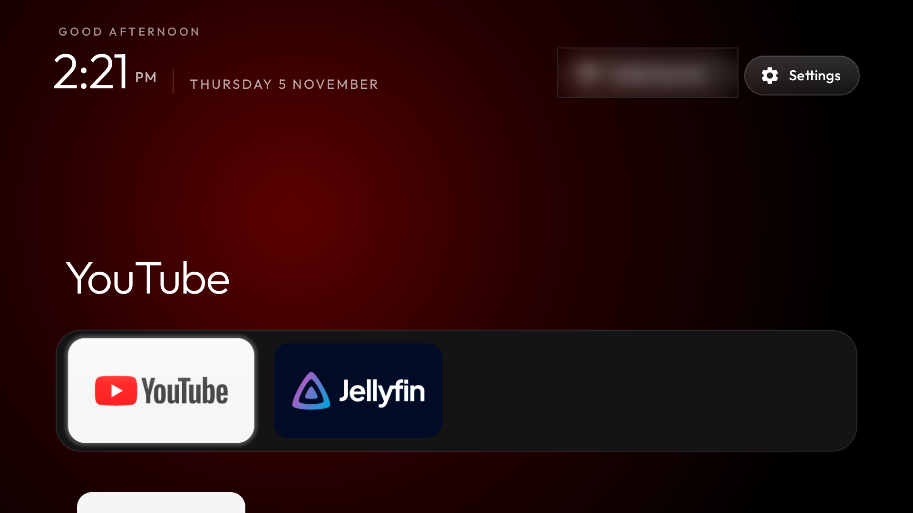

# Your TV: what was changed, and how to undo it

TV: Xiaomi Mi TV Stick 4K, model **MiTV-AYFR0** (codename `soul`), Android TV 11 (SDK 30),
firmware `RTT0.211222.001.1546`, at `<tv ip>`.

Everything below was done with [Gathin23/cleanyourtv](https://github.com/Gathin23/cleanyourtv).
Nothing was uninstalled and nothing was flashed: apps are only switched off per user (`pm disable-user`),
which is the same switch as Settings > Apps > Disable.

## Before and after

| Before | After |
|---|---|
|  |  |
| The stock launcher, with the sponsored "Mi Recommends" row | The new Home, dock holding YouTube and Jellyfin |




The Wi-Fi network name and the Google account avatar are blurred in these; both were visible in the
originals.

## What changed

1. **21 preloaded/telemetry packages disabled** — Xiaomi analytics, PatchWall content rows
   (`com.mitv.tvhome.*`, `com.xm.webcontent`), the auto-installer configs, Google feedback/partner
   setup, contacts + calendar sync, and the preloads you don't use (Netflix, Prime Video, YouTube Music,
   Play Games, TalkBack, Xiaomi video player, print spooler, Ambient Mode). The Xiaomi firmware update
   service is off too, as you asked.
2. **New home screen** `com.gathin.tvhome` built from the repo's launcher and set as Home.
   Dock: YouTube, Jellyfin.
3. **The stock launcher** `com.google.android.tvlauncher` was disabled *after* the new Home was verified,
   which is the order the repo enforces so the TV can never be left without a home screen.

Still enabled on purpose: YouTube, Jellyfin, Play Store, Google Play Services, Google Assistant,
Chromecast, the TV Settings app, and everything Android itself needs to boot.

`com.google.android.youtube.tvkids` and `com.mitv.smartshare` (Miracast) were already disabled by Xiaomi
before we started; they were left exactly as they were.

## Undo everything

The restore state was recorded before the first change and is stored in two places:

- `C:\Users\MM\.cleanyourtv\recovery-<tv ip>-6fb5b3ba.json`
- `backup\recovery-<tv ip>-6fb5b3ba.json` (inside the repo copy)

Turn network debugging on again on the TV, then from `C:\Users\MM\Documents\deepseek-harness\default-workspace\cytt`:

```powershell
$env:TV_HOST = '<tv ip>'
& .\tools\restore.ps1 -TvHost <tv ip> examples\xiaomi-mitv-ayfr0\debloat.txt
```

That re-enables the packages this run disabled (packages that were already off stay off) and gives Home
back to the stock launcher. The custom launcher stays installed; remove it from Settings > Apps if you
want it gone.

## Undo one app instead

```powershell
& .\tools\tv.py 'pm enable --user 0 com.netflix.ninja'
```

Useful names: `com.netflix.ninja`, `com.amazon.amazonvideo.livingroom`,
`com.google.android.youtube.tvmusic`, `com.google.android.play.games`,
`com.google.android.marvin.talkback`, `com.mitv.videoplayer`, `com.xiaomi.mitv.updateservice`,
`com.google.android.backdrop` (Ambient Mode), `com.android.printspooler`.

## Change the dock, the app order or the grid

Edit `launcher\app\src\main\res\values\config.xml` (or push a theme instead, `tools\theme.ps1`):

- `dock_apps` — the dock, in order (currently YouTube, then Jellyfin)
- `fill_dock` — `false` now, so the dock holds exactly those two apps; `true` fills empty dock slots
  with the first grid apps
- `columns` — tiles per row, 4 to 7
- `hidden_apps` — apps never shown as tiles
- `live_tv_package` — empty here, since a stick has no tuner or HDMI input

Then rebuild and reinstall:

```powershell
$env:JAVA_HOME = "$PWD\work\toolchain\jdk17"
$env:ANDROID_HOME = "$PWD\work\toolchain\sdk"
$env:ANDROID_USER_HOME = "$PWD\work\android-home"
$env:GRADLE_USER_HOME = "$PWD\work\gradle"
$env:SKIP_BUILD = '1'   # drop this line to rebuild first
& .\launcher\build-and-install.ps1 -TvHost <tv ip>
```

Most settings (dock order, columns, hidden apps) can also be changed on the TV itself: hold OK on
**Settings** in the top right.

## After a firmware update

An update reinstalls over the cleaned system, so the listed packages come back. Compare and re-apply:

```powershell
& .\tools\venv\Scripts\python.exe -I tools\check.py examples\xiaomi-mitv-ayfr0\debloat.txt
& .\tools\venv\Scripts\python.exe -I tools\check.py examples\xiaomi-mitv-ayfr0\debloat.txt --fix
```

The update service is disabled, so updates only arrive if you re-enable `com.xiaomi.mitv.updateservice`.

## Build environment (only needed to rebuild the launcher)

It is all inside this folder, nothing was installed system-wide:

- `work\toolchain\jdk17` — Temurin JDK 17
- `work\toolchain\sdk` — Android SDK platform 34 + build-tools 34.0.0
- `work\gradle` — Gradle cache
- `work\android-home` — Android's user dir (debug keystore lives here)

Note: `sdkmanager` itself can't write to `C:\Users\MM\.android` in this sandbox, so the SDK packages
were downloaded directly from Google's repository index instead. That only matters if you need more
SDK packages later.

## Credit

Nearly everything in this repository is other people's work, used under the MIT licence. None of it is
mine, and none of it should be judged by the state of this copy.

| Who | What |
|---|---|
| **[Gathin (@Gathin23)](https://github.com/Gathin23)** — [CleanYourTV](https://github.com/Gathin23/cleanyourtv) · https://cleanyour.tv | The whole project: `tools/tv.py` (the pure-Python ADB client), `disable` / `restore` / `check` and their Home, TV-input and handler guards, `recovery.py` and the restore record, the launcher in `launcher/`, `PROMPT.md` and the safety rules in it, and the documentation. MIT licence, Copyright © 2026 Gathin. |
| **[@steepenergy](https://github.com/steepenergy)** | The `examples/xiaomi-mitv-ayfr0/` debloat list this TV used — the package names, and the notes in its header about this exact stick (no tuner, the HOME claimants, the remote's Home key, CEC One Touch Play). |
| **CleanYourTV's contributors** | The 170+ TV lists and 433 tested models, the themes, the device notes and the troubleshooting entries that made this a fifteen-minute job instead of an afternoon of guesswork. |

**My contribution to this copy is only** the per-TV `launcher/.../config.xml` (dock = YouTube and
Jellyfin, `fill_dock` off, no Live TV package), the notes and screenshots in this file, and running the
sequence on the device.

If you came here looking for the tool rather than for this TV's settings, go upstream:
**[github.com/Gathin23/cleanyourtv](https://github.com/Gathin23/cleanyourtv)**. If the MiTV-AYFR0 list
helped you, the useful contribution is a list for *your* model there, not a change to this copy. See
[CONTRIBUTING.md](CONTRIBUTING.md).
